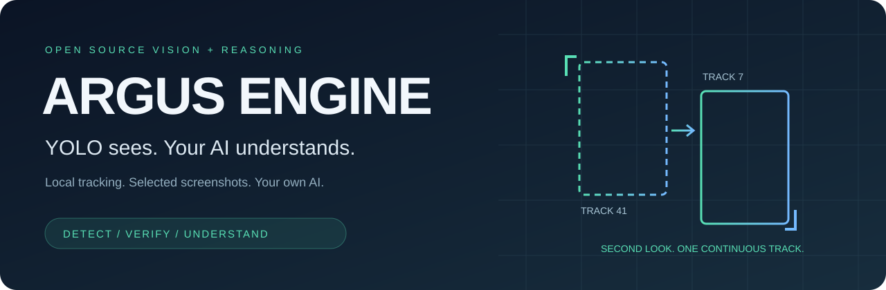
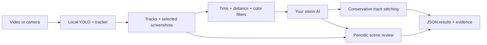

<div align="center">



# ARGUS Engine

### YOLO sees. Your AI understands.

**Give your object tracker a second look.**

Local YOLO tracking. Selective screenshots. A vision model of your choice.
One open engine that connects them.

[](https://github.com/ayshahawy-cmd/argus-engine/actions/workflows/ci.yml)
[](LICENSE)


[Try the demo](#try-it-in-a-minute) · [Use your own AI](#bring-your-own-ai) · [How it works](#how-it-works) · [Contribute](CONTRIBUTING.md)

</div>

## Beyond bounding boxes

A person disappears behind a shelf. The tracker loses them. They reappear with
a new ID. One visit becomes two.

ARGUS adds a visual reasoning step: capture useful evidence, ask your AI to
compare the before-and-after crops, and connect the tracks when the answer is
an explicit **SAME**. Periodic scene screenshots give that same AI a wider view
of what is happening beyond the boxes.

**The idea is simple: detect locally, look again selectively, reason with your own AI.**

Extracted from the tracking and screenshot reasoning pipeline behind ARGUS /
OpnReality, this repository opens the engine for developers to study, adapt,
and build on. It includes the tracking adapter, candidate filtering, crop
selection, visual review, scene observations, and structured results.

ARGUS is an orchestration layer around YOLO, with no new detector weights or
changes to YOLO's neural network. The AI can revise track associations and
describe scenes; it can also make mistakes. This alpha has no published
accuracy, speed, or cost benchmark. See [evaluation](docs/EVALUATION.md).

## How it works



1. **Detect and track locally.** The optional Ultralytics adapter tracks people
   with YOLO and BoT-SORT or ByteTrack.
2. **Capture the useful evidence.** Keep the largest eligible crop per track
   and a bounded set of scene snapshots. Apply coarse head redaction by default.
3. **Spend reasoning where it matters.** Time, position, and color filters
   reduce the pairs that reach your model.
4. **Let your AI take a second look.** Two crops go in; `SAME`, `DIFFERENT`, or
   `UNSURE` comes back. Only exact `SAME` can join eligible tracks. Overlap and
   branching checks constrain merges.
5. **Keep the evidence.** Export decisions, timestamps, track associations,
   estimated visit spans, observations, token usage, and an optional summary.

Capture runs first; AI review runs afterward. For cameras and streams, set a
finite `--max-seconds` so review can begin. This release is a batch/windowed
pipeline; it does not stream AI corrections back into the live YOLO tracker.

## Try it in a minute

Requires Python 3.10 or newer.

```bash
git clone https://github.com/ayshahawy-cmd/argus-engine.git
cd argus-engine
python3 -m venv .venv
source .venv/bin/activate
python -m pip install -e .
argus-engine demo
```

```text
SYNTHETIC DEMO: scripted detections and model responses; no API calls.
Tracks: 2; estimated visitors: 1; merges: 1; model calls: 5
Results: output/<run-id>/result.json
```

The demo uses generated rectangles, scripted track IDs, and scripted model
responses. It demonstrates the pipeline without a camera, model download,
API key, or network request. Its output is an illustration, not an accuracy result.

### Run YOLO on your own video

```bash
python -m pip install -e '.[yolo]'
argus-engine run --source /path/to/video.mp4 --provider none
```

This saves tracks and selected evidence locally with zero vision-model calls.
The first YOLO run may download the selected detector weights. Review
[dependency licensing](THIRD_PARTY_NOTICES.md) before using the optional detector.

On Apple silicon, use a native ARM Python. For legacy Intel macOS / Rosetta
Python, use Python 3.10–3.12; the YOLO extra constrains NumPy and OpenCV for the
older PyTorch wheels available on that platform.

### Add your own AI

For Claude, install the adapter and set your own environment variables:

```bash
python -m pip install -e '.[yolo,anthropic]'
read -r -s -p 'Anthropic API key: ' ANTHROPIC_API_KEY; echo
export ANTHROPIC_API_KEY
export ARGUS_ANTHROPIC_MODEL='your-vision-capable-model-id'

argus-engine run --source /path/to/video.mp4 --provider anthropic \
  --config examples/config.json
```

The key prompt above uses Bash. In other shells, set the same environment
variables using your shell's secret-input mechanism. Provider selection sends
selected JPEGs and prompts to that provider and can incur its API charges.
Keys come from your environment; none are included in this repository.
The `.env.example` file documents variable names and is not loaded automatically.

For an OpenAI-compatible vision service:

```bash
python -m pip install -e '.[yolo,openai]'
# Set OPENAI_API_KEY using your shell's secret-input mechanism.
export ARGUS_OPENAI_MODEL='your-vision-capable-model-id'
# Optionally set OPENAI_BASE_URL for a compatible cloud or local endpoint.

argus-engine run --source /path/to/video.mp4 --provider openai
```

The compatible adapter uses Chat Completions with JPEG data URLs and
`max_completion_tokens`. Your endpoint must support those fields, vision input,
and text-only summary requests. Providers and model IDs are deliberately
configurable; model availability changes.

For a private camera URL, keep it out of shell history and process arguments:

```bash
# Set CAMERA_URL in your environment using your shell's secret-input mechanism.
argus-engine run --source-env CAMERA_URL --max-seconds 120 --provider anthropic
```

Use `--source 0 --max-seconds 30` for a webcam. Stream timestamps use elapsed
capture time; video files use frame index and the file's reported FPS.

## Bring your own AI

The core requires only Pillow. It has no hard dependency on a detector, cloud
SDK, hosted backend, database, or dashboard.

Implement one method to connect a vision model you control:

```python
from argus_engine import Engine, VisionResponse
from argus_engine.detectors import YoloTracker


class MyVisionModel:
    def complete(self, prompt, images=(), *, max_tokens=300):
        # images is a tuple of local JPEG Paths. Call your model here.
        # Return SAME / DIFFERENT / UNSURE for crop-comparison prompts.
        return VisionResponse("UNSURE\nConnect your vision model here.")


result = Engine(provider=MyVisionModel()).run(YoloTracker("video.mp4"))
print(result.output_dir / "result.json")
```

You can also supply any iterable of `FramePacket` objects to replace YOLO.
Each packet contains a timestamp, a PIL image, and detections with stable
track IDs and pixel-coordinate bounding boxes. Use this for your own detector,
recorded detections, or a different tracker.

Prompts are editable in [`prompts.py`](src/argus_engine/prompts.py) and can be
passed directly to `Engine`. See [the custom-provider example](examples/custom_provider.py)
and [architecture](docs/ARCHITECTURE.md).

## Control the reasoning budget

[`examples/config.json`](examples/config.json) exposes the engine's thresholds.
Default limits are 50 crop-comparison calls, 60 scene calls, and one summary
call per run: **at most 111 provider invocations**, with built-in SDK retries
disabled. Actual token usage and provider pricing determine the bill; call
limits are not a dollar budget. Custom providers control their own retries.

Increase `scene_interval_seconds`, lower the call limits, or set
`generate_summary` to `false` to reduce requests. Set `max_scene_frames` to
zero to disable scene captures; set `max_reid_calls` to zero to disable visual
track review. `--provider none` disables every AI request.

## Inspect the result

Each run gets an isolated directory:

```text
output/<run-id>/
├── crops/        # selected per-track JPEGs
├── scenes/       # sampled scene JPEGs
├── tracks.json  # kept tracks and their merge links
└── result.json  # estimates, decisions, evidence paths, observations, usage
```

`estimated_visitors` counts the remaining track groups, including anyone the
person detector tracks. It does not distinguish customers from staff.
`span_seconds` is first-to-last observation time and includes occlusion gaps.
Source URLs and API keys are not written into run metadata.

## Privacy and limits

Use footage you are authorized to process. With a provider enabled, selected
crops and scene screenshots leave your machine for the configured endpoint;
the summary request also includes tracking estimates and scene observations.
There is no separate hosted storage upload in this engine.

Head redaction covers the upper 35% of each detected person's box, both in
crops and scenes, before saving or sending. This is a coarse heuristic and
**does not guarantee anonymization**: missed detections, faces outside boxes,
clothing, background text, and other identifying details can remain. Output
files persist until you delete them; there is no automatic retention policy.

AI decisions are fallible. Similar clothing can cause false merges; appearance
changes, camera motion, or redaction can cause missed matches. Inspect the
audit trail and validate on representative footage. This release focuses on
short-gap, same-camera track continuity, not cross-camera identity matching.

## Build it with us

Useful next steps include labeled evaluation clips, better ambiguity handling,
additional vision adapters, stronger redaction hooks, and live review queues.
See [contributing](CONTRIBUTING.md) and [the evaluation plan](docs/EVALUATION.md).

```bash
python -m pip install -e '.[dev]'
ruff check .
pytest -q
python -m build
```

Tests and the synthetic demo run without credentials or paid inference.

## License and credits

ARGUS's original engine code is released under the **[MIT License](LICENSE)**.
Built by **Ahmed Elshahawi**.

YOLO and the tracking ecosystem make the local detection layer possible.
The optional Ultralytics package and its weights have their own
**AGPL-3.0 / Enterprise** licensing; this repository's MIT license does not
relicense them or remove obligations from a combined deployment.
Read [third-party notices](THIRD_PARTY_NOTICES.md) and
[Ultralytics' licensing terms](https://www.ultralytics.com/license).

**Detect. Verify. Understand. Build the next layer of computer vision.**
